# 火车订票管理系统

> 🎓 **计算机毕业设计 · 火车订票管理系统**
>
> 本仓库只放**项目介绍 + 运行截图**（截图是站点带水印的原图，存在仓库 `images/` 里）。
>
> 👉 **完整可运行源码 / 数据库脚本 / 部署文档：[点我获取](https://geekcode.top/archives/%E7%81%AB%E8%BD%A6%E8%AE%A2%E7%A5%A8%E7%AE%A1%E7%90%86%E7%B3%BB%E7%BB%9F?utm_source=github)**
>
> 💬 咨询微信：**ir9372**　|　🌐 更多项目：[极客代码 geekcode.top](https://geekcode.top/?utm_source=github)
>
> 📌 项目详情页：<https://geekcode.top/archives/%E7%81%AB%E8%BD%A6%E8%AE%A2%E7%A5%A8%E7%AE%A1%E7%90%86%E7%B3%BB%E7%BB%9F?utm_source=github>

<table><td width="230" align="center"> <b>扫码加微信 ir9372</b></td><td valign="middle">📦 源码 = 项目介绍 + 全部运行截图 + 数据库 + 部署文档 👉 点上方任意截图，直接跳到 <b>极客代码 geekcode.top</b> 详情页</td></table>

---

<h1>火车订票管理系统</h1>
<h2>项目概述</h2>

火车订票管理系统旨在解决传统火车票务查询、预订及售后流程效率低下的问题，构建一个集车次查询、在线购票、订单管理及资讯发布于一体的综合服务平台。系统核心功能涵盖前台用户端的车次与车型信息浏览、火车资讯获取、个人中心管理以及购票、改签、退票全流程操作；后台管理端则提供对车次、车型、资讯、各类订单及用户数据的全面管控。该系统适用于普通旅客进行自助票务服务，同时为管理员提供高效的数据维护与业务审核工具。技术架构采用前后端分离模式，后端基于 Spring Boot 框架构建 RESTful API，前端使用 Vue 框架实现交互界面，数据持久层采用 MyBatis-Plus，并通过 Apache Shiro 实现安全权限控制，确保系统的稳定性与安全性。

<h2>技术架构</h2>

本项目采用典型的前后端分离架构设计，各层级职责清晰，耦合度低。

<strong>1. 后端架构</strong>
后端基于 <strong>Spring Boot</strong> 框架开发，利用其自动配置特性快速搭建 Web 应用基础。

<ul>
<li><strong>Web 层</strong>：使用 <code>spring-boot-starter-web</code> 处理 HTTP 请求，通过 Controller 层（如 <code>ChecixinxiController</code>, <code>GoupiaodingdanController</code> 等）接收前端请求并返回 JSON 格式数据。</li>
<li><strong>安全层</strong>：集成 <strong>Apache Shiro</strong> (<code>shiro-spring</code>) 进行身份认证与授权管理，保护接口安全，区分不同角色的访问权限。</li>
<li><strong>数据访问层</strong>：采用 <strong>MyBatis-Plus</strong> (<code>mybatis-plus</code>, <code>mybatisplus-spring-boot-starter</code>) 作为 ORM 框架，简化 CRUD 操作，支持动态 SQL 生成。底层数据库驱动为 <code>mysql-connector-java</code>，配合 <code>spring-boot-starter-jdbc</code> 进行连接池管理与事务控制。</li>
<li><strong>通用组件</strong>：引入 <code>commons-lang3</code> 处理字符串与对象工具类，<code>validation-api</code> 用于参数校验，<code>protobuf-java</code> 可能用于特定场景的高效序列化或通信协议支持。</li>
</ul>

<strong>2. 前端架构</strong>
前端采用 <strong>Vue</strong> 框架（根据项目类型 vue-integrated 推断），构建单页应用（SPA）。

<ul>
<li><strong>视图层</strong>：分为“前台用户端”和“后台管理端”。前台包含首页、登录注册、车次/车型/资讯列表及详情页、个人中心（含各类订单列表与详情）；后台包含登录页及针对新闻、退票、车次、车型、改签、用户、购票、配置等模块的管理页面。</li>
<li><strong>路由管理</strong>：通过 Vue Router 实现页面跳转，后台路由包括 <code>/news</code>, <code>/tuipiaodingdan</code>, <code>/checixinxi</code> 等，前台虽无显式路由列表但具备完整的页面导航结构。</li>
</ul>

<strong>3. 数据库设计要点</strong>
基于控制器名称及业务逻辑，数据库主要实体包括：

<ul>
<li><strong>基础信息表</strong>：车次信息 (<code>Checixinxi</code>)、车型信息 (<code>Chexingxinxi</code>)、火车资讯 (<code>News</code>)。</li>
<li><strong>业务交易表</strong>：购票订单 (<code>Goupiaodingdan</code>)、改签订单 (<code>Gaiqiandingdan</code>)、退票订单 (<code>Tuipiaodingdan</code>)。</li>
<li><strong>系统与用户表</strong>：用户信息 (<code>Yonghu</code>)、系统配置 (<code>Config</code>)。
设计遵循第三范式，确保数据冗余最小化，并通过外键关联维持车次、订单与用户之间的引用完整性。</li>
</ul>
<h2>功能模块</h2>
<h3>前台用户端</h3>

前台面向普通注册用户，提供自助式票务服务与信息查阅功能。

<ol>
<li><strong>账号体系</strong></li>
</ol>
<ul>
<li><strong>登录/注册</strong>：用户可通过填写个人信息完成注册，并使用账号密码登录系统。</li>
<li><strong>个人中心</strong>：查看和修改个人基本信息，管理账户状态。</li>
</ul>
<ol start="2">
<li><strong>信息查询模块</strong></li>
</ol>
<ul>
<li><strong>车次信息</strong>：展示所有可选车次的列表，点击可进入详情页查看具体时刻、站点、余票等信息。</li>
<li><strong>车型信息</strong>：展示不同列车类型的介绍列表，支持查看详情，帮助用户了解硬件设施与服务标准。</li>
<li><strong>火车资讯</strong>：发布铁路相关新闻、公告或旅行指南，支持列表浏览与文章详情阅读。</li>
</ul>
<ol start="3">
<li><strong>订单管理模块</strong></li>
</ol>
<ul>
<li><strong>购票订单</strong>：用户可查看历史及当前有效的购票记录，支持查看详情中的座位号、金额、时间等关键信息。</li>
<li><strong>改签订单</strong>：展示用户发起的车次变更申请记录，支持查看改签后的新行程详情及处理状态。</li>
<li><strong>退票订单</strong>：展示用户的退票申请记录，支持查看退款进度、手续费扣除情况及最终结果。</li>
</ul>
<h3>后台管理端</h3>

后台面向管理员，提供全量数据的增删改查及系统配置功能。

<ol>
<li><strong>内容管理</strong></li>
</ol>
<ul>
<li><strong>车次信息管理</strong> (<code>/checixinxi</code>)：录入、编辑、删除车次数据，维护发车时间、到达时间、票价、剩余票数等核心字段。</li>
<li><strong>车型信息管理</strong> (<code>/chexingxinxi</code>)：维护车型类别、座位布局描述、设施图片等非结构化或半结构化数据。</li>
<li><strong>火车资讯管理</strong> (<code>/news</code>)：发布、编辑、下架铁路资讯文章，支持富文本内容管理。</li>
</ul>
<ol start="2">
<li><strong>订单业务管理</strong></li>
</ol>
<ul>
<li><strong>购票订单管理</strong> (<code>/goupiaodingdan</code>)：查看所有用户的购票记录，支持搜索、筛选及异常订单处理。</li>
<li><strong>改签订单管理</strong> (<code>/gaiqiandingdan</code>)：审核和处理用户的改签请求，更新订单状态以同步库存。</li>
<li><strong>退票订单管理</strong> (<code>/tuipiaodingdan</code>)：审核退票申请，执行退款操作或标记拒绝原因，维护财务数据准确性。</li>
</ul>
<ol start="3">
<li><strong>系统设置</strong></li>
</ol>
<ul>
<li><strong>用户管理</strong> (<code>/yonghu</code>)：查看注册用户列表，重置密码或禁用违规账号。</li>
<li><strong>配置文件</strong> (<code>/config</code>)：管理系统全局参数，如轮播图链接、网站标题、客服电话等基础配置项。</li>
</ul>
<h2>用户角色与权限</h2>

系统主要划分为两类角色：<strong>普通用户</strong>与<strong>管理员</strong>。基于 Shiro 框架实现权限隔离。

<table>
<thead>
<tr>
<th align="left">角色</th>
<th align="left">权限范围</th>
<th align="left">可访问功能模块</th>
</tr>
</thead>
<tbody><tr>
<td align="left"><strong>普通用户</strong></td>
<td align="left">仅限个人数据读写及公共信息浏览</td>
<td align="left"><strong>前台</strong>：1. 登录/注册2. 浏览车次信息、车型信息、火车资讯3. 创建购票订单4. 发起改签、退票申请5. 查看个人中心的各类订单详情6. 修改个人基本信息</td>
</tr>
<tr>
<td align="left"><strong>管理员</strong></td>
<td align="left">拥有系统最高权限，可操作所有业务数据</td>
<td align="left"><strong>后台</strong>：1. 后台登录2. 车次信息的增删改查3. 车型信息的增删改查4. 火车资讯的发布与管理5. 购票订单的查询与管理6. 改签订单的审核与管理7. 退票订单的处理与管理8. 用户账号的管理9. 系统配置文件的维护</td>
</tr>
</tbody></table>

<em>注：普通用户无法访问任何后台管理路由；管理员通常不直接参与前台的业务下单操作，专注于数据维护与业务审核。</em>

<h2>项目特色与创新点</h2>
<ol>
<li><strong>全流程闭环管理</strong>：系统不仅覆盖了传统的“查询-购票”正向流程，还完整实现了“改签”与“退票”逆向业务流程。通过独立的 <code>Gaiqiandingdan</code> 和 <code>Tuipiaodingdan</code> 控制器与页面，确保了售后服务的规范化与可追溯性，解决了传统系统中售后环节缺失或混乱的问题。</li>
<li><strong>多维度的信息展示</strong>：除了核心的车次信息外，引入了“车型信息”模块，将列车硬件条件（如座位类型、设施等级）独立建模并展示，提升了用户决策的信息维度，体现了以用户体验为中心的设计思路。</li>
<li><strong>安全与效率并重</strong>：采用 Shiro 进行细粒度的权限控制，结合 MyBatis-Plus 的代码生成器优势，大幅减少了重复性的 DAO 层代码编写，提高了开发效率与维护性。同时，前后端分离架构使得界面响应更流畅，便于后续扩展移动端适配。</li>
<li><strong>灵活的配置中心</strong>：通过专门的 <code>ConfigController</code> 和后台配置页面，将非代码级的业务参数（如宣传语、联系方式）剥离出来，实现了运营人员无需重启服务即可动态调整前端展示内容的需求。</li>
</ol>
<h2>部署环境</h2>

为确保火车订票管理系统正常运行，需准备以下软硬件环境：

<strong>1. 硬件要求</strong>

<ul>
<li>CPU: 双核及以上处理器</li>
<li>内存: 建议 4GB RAM 以上（开发环境建议 8GB）</li>
<li>硬盘: 至少 10GB 可用空间用于存储日志、上传文件及数据库数据</li>
</ul>

<strong>2. 软件环境</strong>

<ul>
<li><strong>操作系统</strong>: Windows 10/11, Linux (CentOS 7+, Ubuntu 18.04+), 或 macOS</li>
<li><strong>Java 开发环境</strong>: JDK 1.8 或更高版本（推荐 JDK 8，以兼容 Spring Boot 旧版依赖）</li>
<li><strong>数据库</strong>: MySQL 5.7 或 MySQL 8.0</li>
<li><strong>构建工具</strong>: Maven 3.6+ （用于后端依赖管理与打包）</li>
<li><strong>Node.js 环境</strong>: Node.js 12.x - 16.x LTS 版本（用于前端 Vue 项目的编译与运行）</li>
<li><strong>包管理器</strong>: npm 或 yarn （配合 Node.js 安装前端依赖）</li>
<li><strong>Web 服务器</strong>: Nginx（生产环境推荐，用于反向代理前端静态资源及转发 API 请求至 Tomcat/Spring Boot 内置容器）</li>
</ul>

<strong>3. 开发工具（可选）</strong>

<ul>
<li>IDE: IntelliJ IDEA 或 Eclipse（后端开发）</li>
<li>编辑器: Visual Studio Code（前端开发）</li>
<li>数据库客户端: Navicat 或 DBeaver</li>
</ul>
<h2>五、技术特性</h2>
<ul>
<li>前后端集成部署，前端资源打包至后端 static 目录</li>
<li>使用 MyBatis-Plus 简化数据访问层开发</li>
<li>集成 Shiro 权限框架实现角色权限控制</li>
</ul>
<h2>六、功能模块截图</h2>
<h3>前台用户端</h3>
<h4>前台首页</h4>

<a href="https://geekcode.top/archives/%E7%81%AB%E8%BD%A6%E8%AE%A2%E7%A5%A8%E7%AE%A1%E7%90%86%E7%B3%BB%E7%BB%9F?utm_source=github" title="查看完整源码">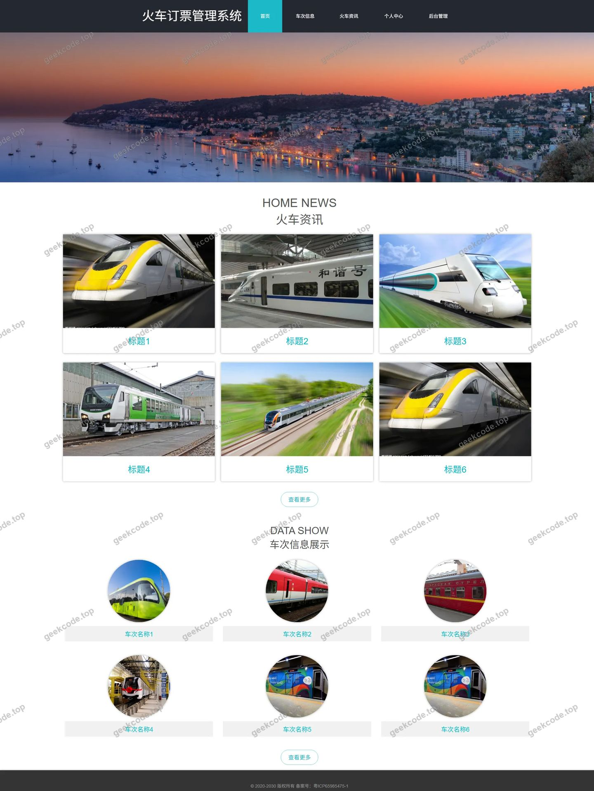</a>

<h4>前台登录页</h4>

<a href="https://geekcode.top/archives/%E7%81%AB%E8%BD%A6%E8%AE%A2%E7%A5%A8%E7%AE%A1%E7%90%86%E7%B3%BB%E7%BB%9F?utm_source=github" title="查看完整源码">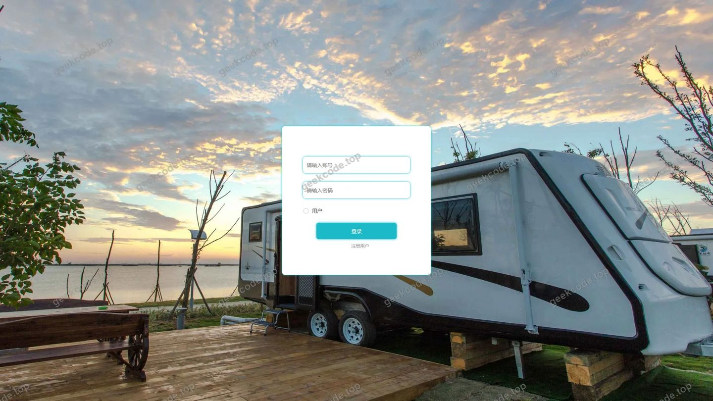</a>

<h4>前台注册页</h4>

<a href="https://geekcode.top/archives/%E7%81%AB%E8%BD%A6%E8%AE%A2%E7%A5%A8%E7%AE%A1%E7%90%86%E7%B3%BB%E7%BB%9F?utm_source=github" title="查看完整源码">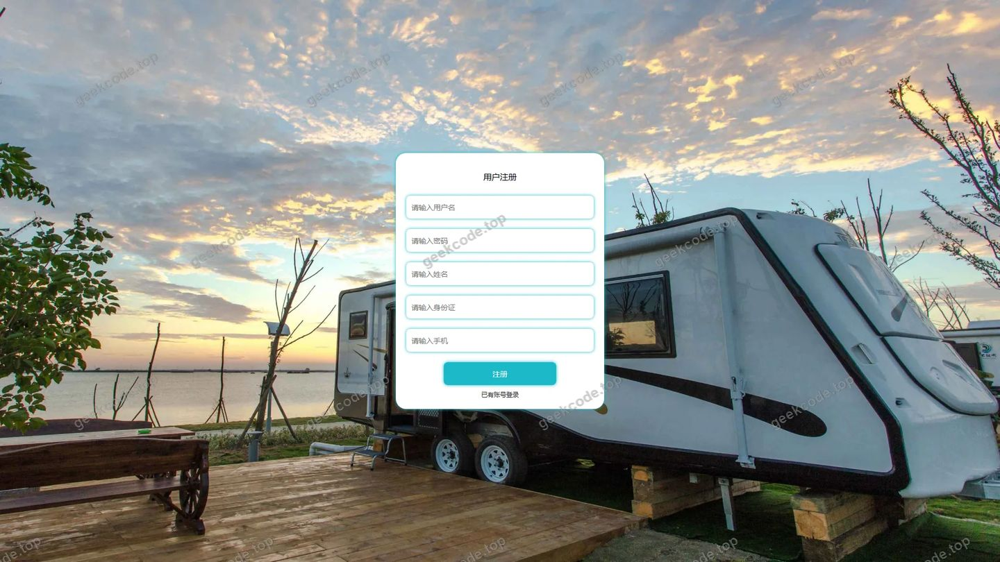</a>

<h4>前台-车次信息列表</h4>

<a href="https://geekcode.top/archives/%E7%81%AB%E8%BD%A6%E8%AE%A2%E7%A5%A8%E7%AE%A1%E7%90%86%E7%B3%BB%E7%BB%9F?utm_source=github" title="查看完整源码">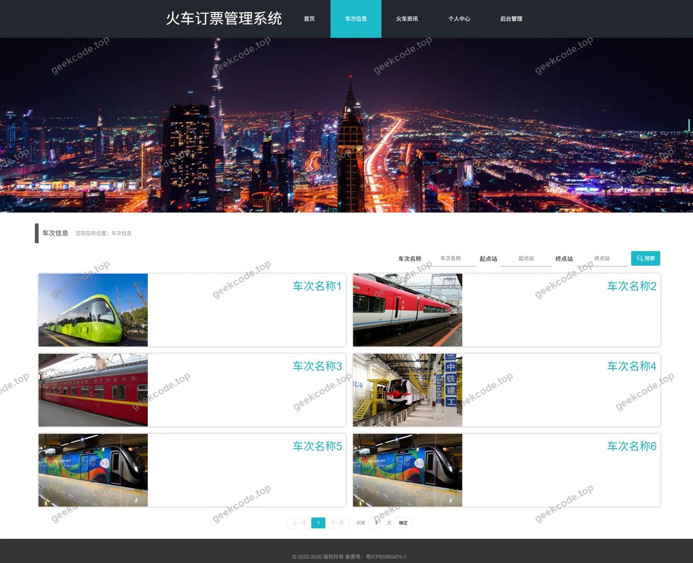</a>

<h4>前台-火车资讯列表</h4>

<a href="https://geekcode.top/archives/%E7%81%AB%E8%BD%A6%E8%AE%A2%E7%A5%A8%E7%AE%A1%E7%90%86%E7%B3%BB%E7%BB%9F?utm_source=github" title="查看完整源码">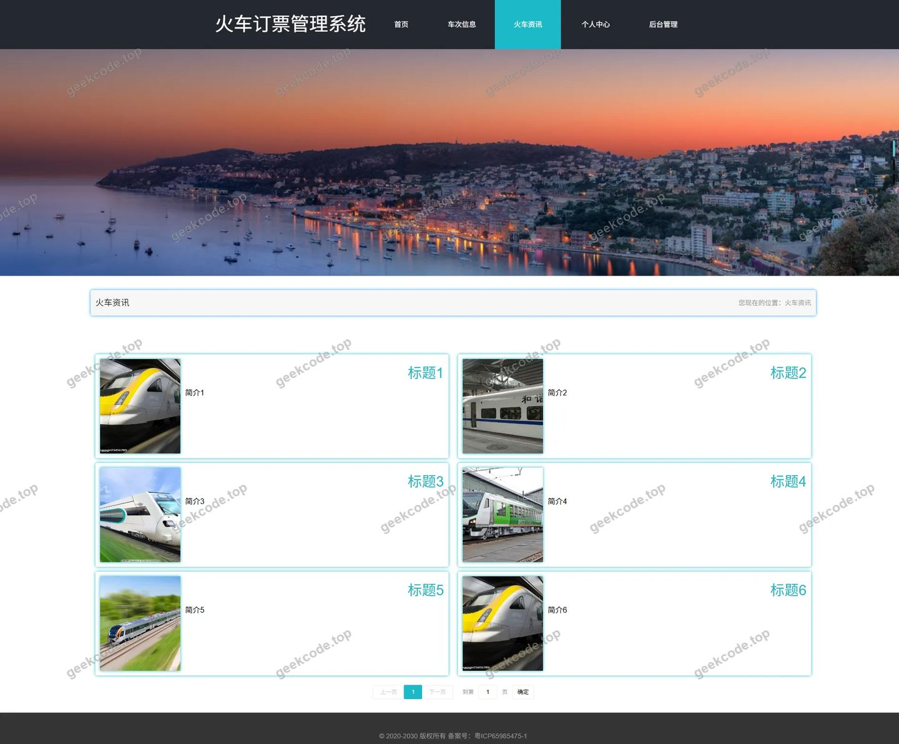</a>

<h4>前台个人中心</h4>

<a href="https://geekcode.top/archives/%E7%81%AB%E8%BD%A6%E8%AE%A2%E7%A5%A8%E7%AE%A1%E7%90%86%E7%B3%BB%E7%BB%9F?utm_source=github" title="查看完整源码">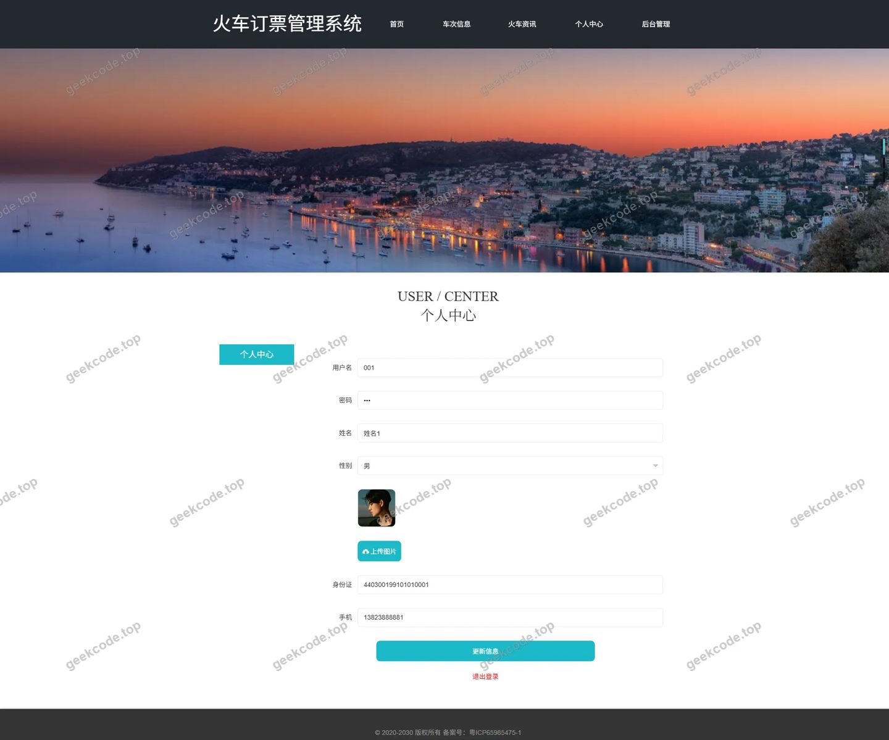</a>

<h4>前台-车次信息-详情</h4>

<a href="https://geekcode.top/archives/%E7%81%AB%E8%BD%A6%E8%AE%A2%E7%A5%A8%E7%AE%A1%E7%90%86%E7%B3%BB%E7%BB%9F?utm_source=github" title="查看完整源码">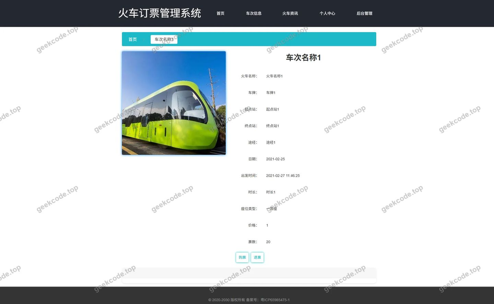</a>

<h4>前台-火车资讯-详情</h4>

<h4>前台-车型信息列表</h4>

<a href="https://geekcode.top/archives/%E7%81%AB%E8%BD%A6%E8%AE%A2%E7%A5%A8%E7%AE%A1%E7%90%86%E7%B3%BB%E7%BB%9F?utm_source=github" title="查看完整源码">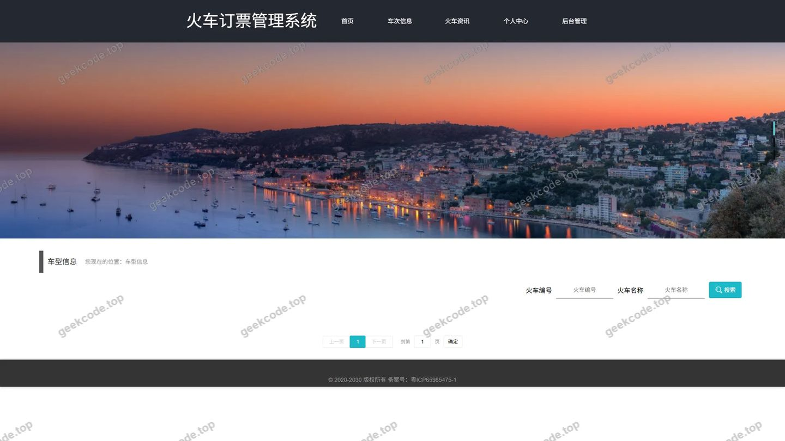</a>

<h4>前台-改签订单列表</h4>

<h4>前台-购票订单列表</h4>

<h4>前台-退票订单列表</h4>

<a href="https://geekcode.top/archives/%E7%81%AB%E8%BD%A6%E8%AE%A2%E7%A5%A8%E7%AE%A1%E7%90%86%E7%B3%BB%E7%BB%9F?utm_source=github" title="查看完整源码">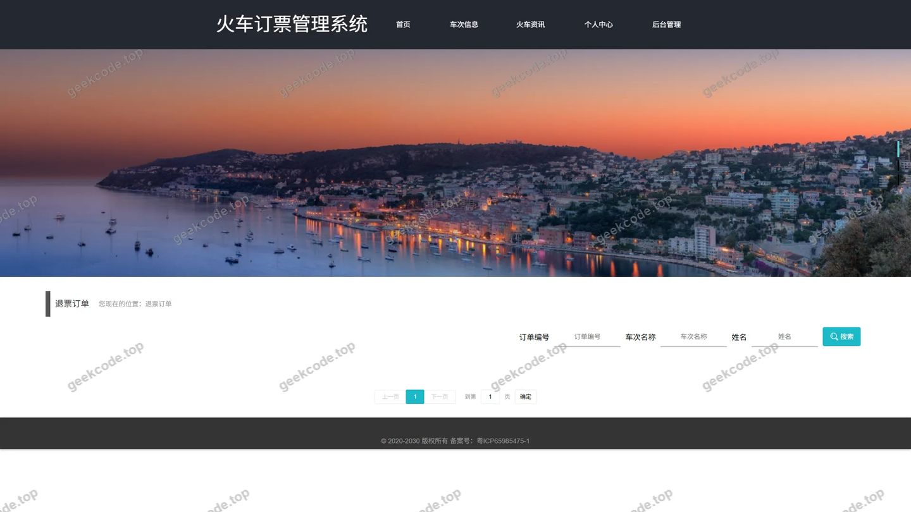</a>

<h4>前台-车型信息-详情</h4>

<a href="https://geekcode.top/archives/%E7%81%AB%E8%BD%A6%E8%AE%A2%E7%A5%A8%E7%AE%A1%E7%90%86%E7%B3%BB%E7%BB%9F?utm_source=github" title="查看完整源码">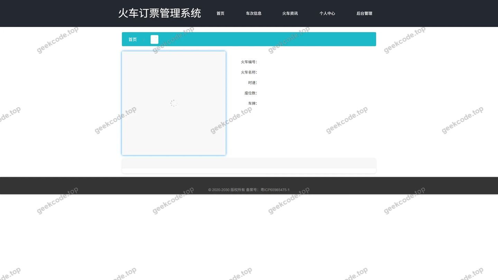</a>

<h4>前台-改签订单-详情</h4>

<h4>前台-购票订单-详情</h4>

<a href="https://geekcode.top/archives/%E7%81%AB%E8%BD%A6%E8%AE%A2%E7%A5%A8%E7%AE%A1%E7%90%86%E7%B3%BB%E7%BB%9F?utm_source=github" title="查看完整源码">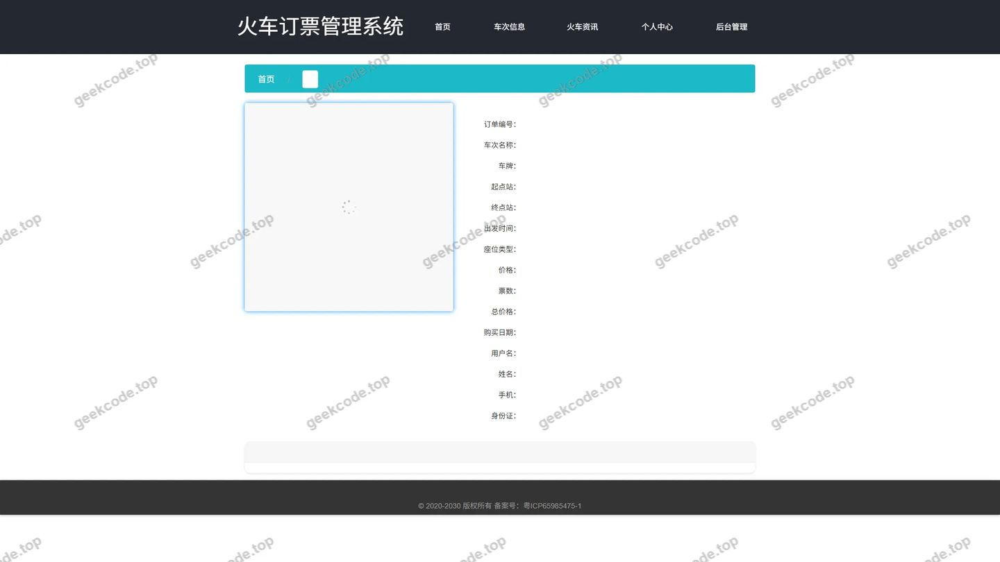</a>

<h4>前台-退票订单-详情</h4>

<a href="https://geekcode.top/archives/%E7%81%AB%E8%BD%A6%E8%AE%A2%E7%A5%A8%E7%AE%A1%E7%90%86%E7%B3%BB%E7%BB%9F?utm_source=github" title="查看完整源码">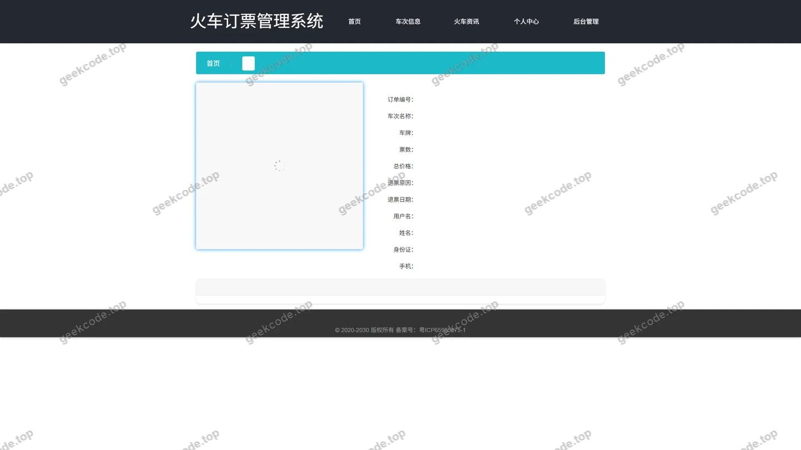</a>

<h3>后台管理端</h3>
<h4>后台-车次信息</h4>

<a href="https://geekcode.top/archives/%E7%81%AB%E8%BD%A6%E8%AE%A2%E7%A5%A8%E7%AE%A1%E7%90%86%E7%B3%BB%E7%BB%9F?utm_source=github" title="查看完整源码">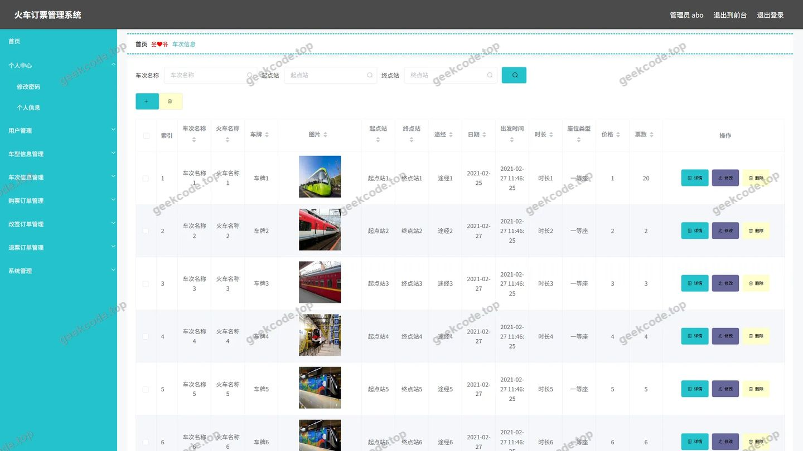</a>

<h4>后台-车型信息</h4>

<a href="https://geekcode.top/archives/%E7%81%AB%E8%BD%A6%E8%AE%A2%E7%A5%A8%E7%AE%A1%E7%90%86%E7%B3%BB%E7%BB%9F?utm_source=github" title="查看完整源码">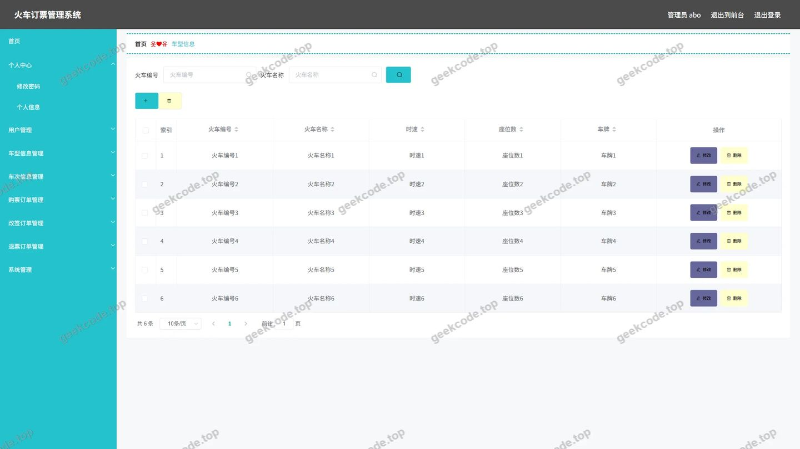</a>

<h4>后台-系统配置</h4>

<a href="https://geekcode.top/archives/%E7%81%AB%E8%BD%A6%E8%AE%A2%E7%A5%A8%E7%AE%A1%E7%90%86%E7%B3%BB%E7%BB%9F?utm_source=github" title="查看完整源码">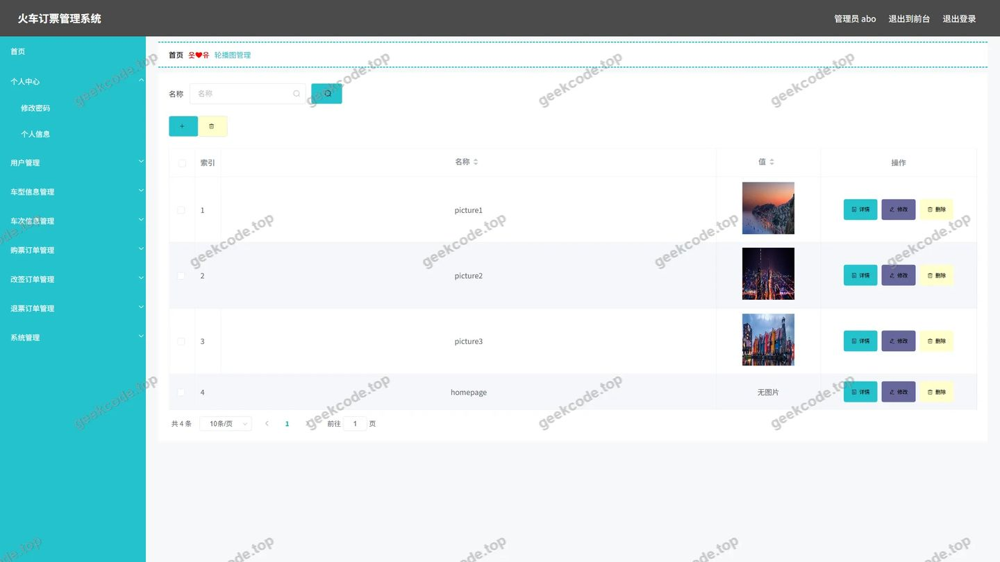</a>

<h4>后台-改签订单</h4>

<a href="https://geekcode.top/archives/%E7%81%AB%E8%BD%A6%E8%AE%A2%E7%A5%A8%E7%AE%A1%E7%90%86%E7%B3%BB%E7%BB%9F?utm_source=github" title="查看完整源码">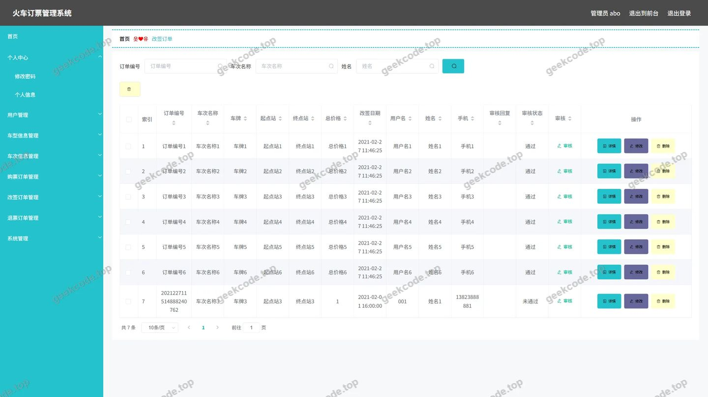</a>

<h4>后台-购票订单</h4>

<a href="https://geekcode.top/archives/%E7%81%AB%E8%BD%A6%E8%AE%A2%E7%A5%A8%E7%AE%A1%E7%90%86%E7%B3%BB%E7%BB%9F?utm_source=github" title="查看完整源码">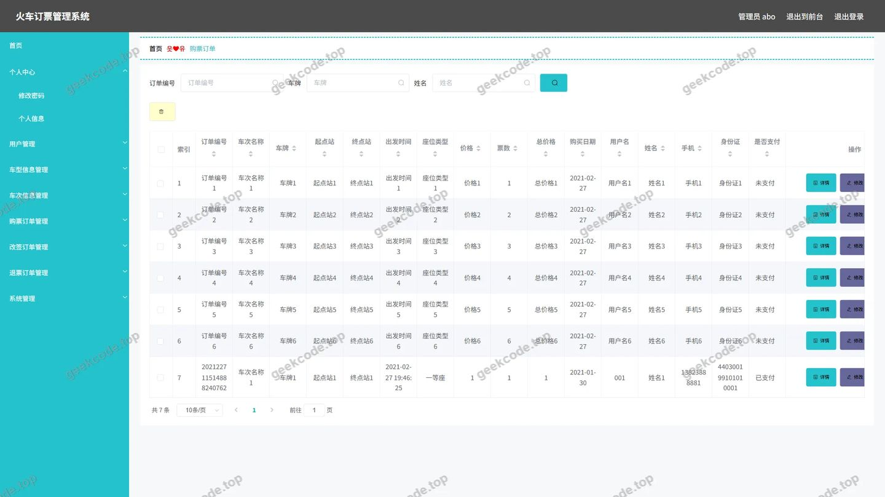</a>

<h4>后台首页</h4>

<a href="https://geekcode.top/archives/%E7%81%AB%E8%BD%A6%E8%AE%A2%E7%A5%A8%E7%AE%A1%E7%90%86%E7%B3%BB%E7%BB%9F?utm_source=github" title="查看完整源码">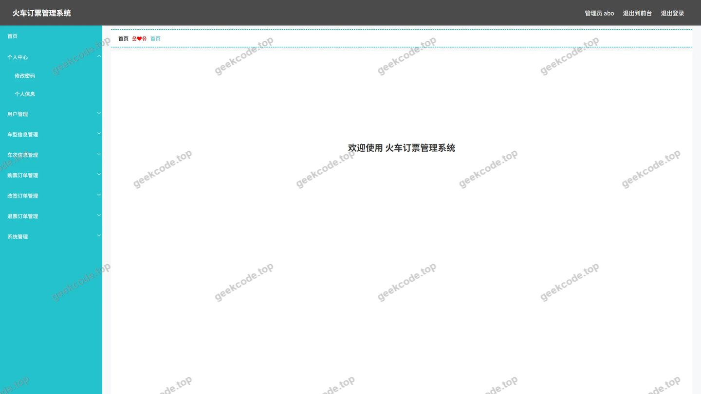</a>

<h4>后台-登录</h4>

<a href="https://geekcode.top/archives/%E7%81%AB%E8%BD%A6%E8%AE%A2%E7%A5%A8%E7%AE%A1%E7%90%86%E7%B3%BB%E7%BB%9F?utm_source=github" title="查看完整源码">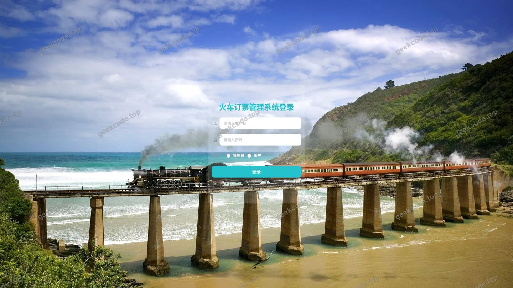</a>

<h4>后台-公告信息</h4>

<a href="https://geekcode.top/archives/%E7%81%AB%E8%BD%A6%E8%AE%A2%E7%A5%A8%E7%AE%A1%E7%90%86%E7%B3%BB%E7%BB%9F?utm_source=github" title="查看完整源码">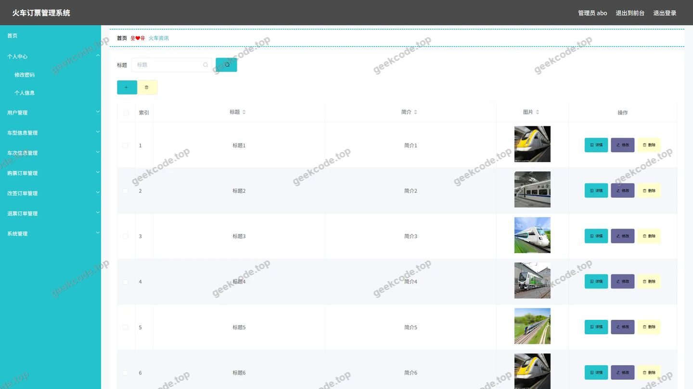</a>

<h4>后台-退票订单</h4>

<a href="https://geekcode.top/archives/%E7%81%AB%E8%BD%A6%E8%AE%A2%E7%A5%A8%E7%AE%A1%E7%90%86%E7%B3%BB%E7%BB%9F?utm_source=github" title="查看完整源码">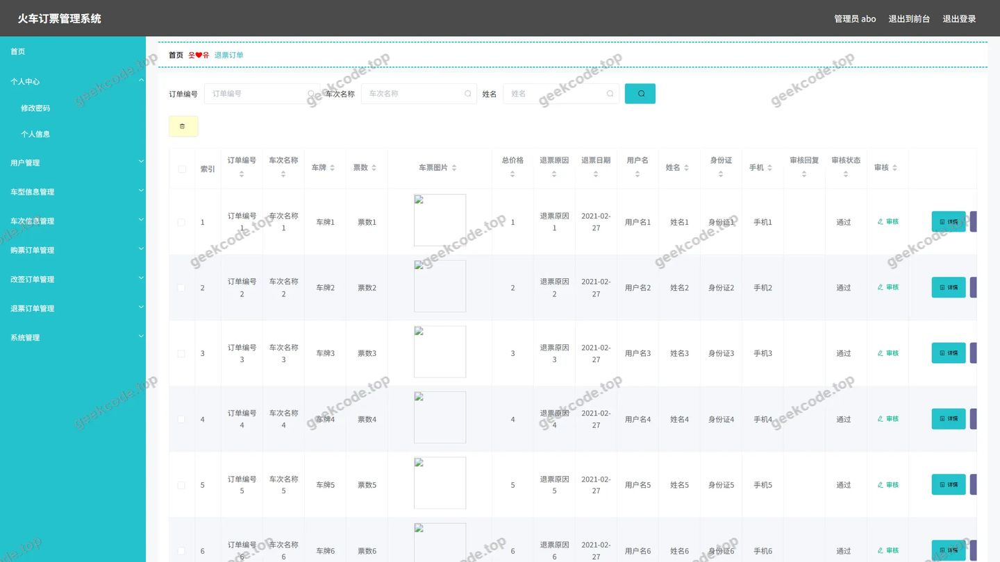</a>

---

## 获取完整源码

| 项目 | 说明 |
| --- | --- |
| 项目名 | 火车订票管理系统 |
| 运行截图 | 本文 25 张（站点带水印原图，仓库 `images/` 目录） |
| 完整源码 | [https://geekcode.top/archives/%E7%81%AB%E8%BD%A6%E8%AE%A2%E7%A5%A8%E7%AE%A1%E7%90%86%E7%B3%BB%E7%BB%9F?utm_source=github](https://geekcode.top/archives/%E7%81%AB%E8%BD%A6%E8%AE%A2%E7%A5%A8%E7%AE%A1%E7%90%86%E7%B3%BB%E7%BB%9F?utm_source=github) |
| 咨询微信 | **ir9372**（备注：jingpin-yuanma） |
| 更多项目 | [极客代码 geekcode.top](https://geekcode.top/?utm_source=github) |

> 需要源码、部署、改配置、跑不起来等问题，加微信 ir9372 沟通，说明项目名即可。
